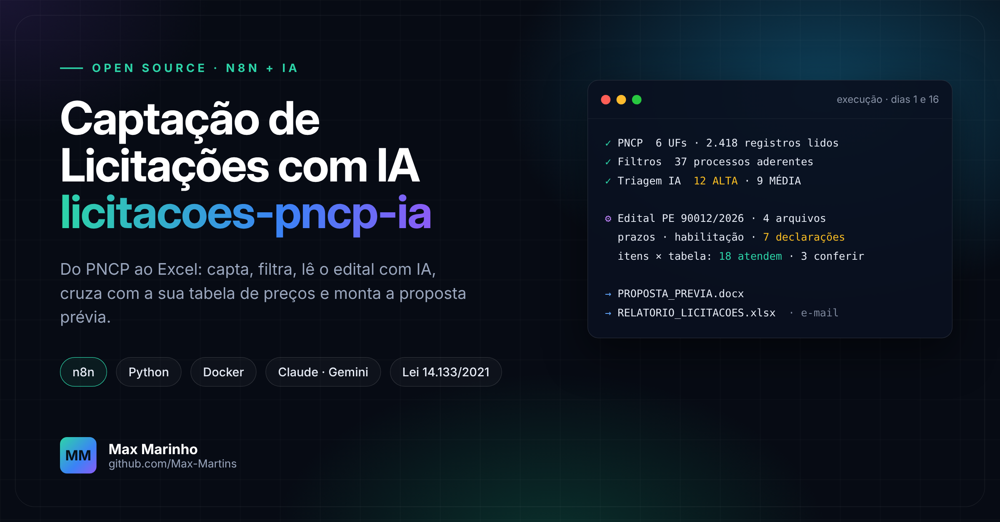
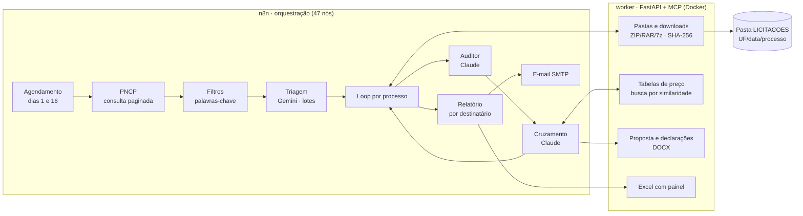

<p align="center">
  
</p>

<h1 align="center">licitacoes-pncp-ia</h1>

<p align="center">
  <b>Automação de ponta a ponta para fornecedores que participam de licitações públicas.</b><br>
  PNCP → n8n → IA (Gemini · Claude · ChatGPT) → Excel, proposta prévia, declarações e e-mail.
</p>

<p align="center">
  
  
  
  
  
  <a href="LICENSE"></a>
  <a href="../../actions/workflows/testes.yml"></a>
</p>

---

## O problema

Todo fornecedor do governo conhece a rotina: abrir o PNCP, filtrar estado por estado, ler centenas de objetos, baixar editais, procurar prazo, garantia e declaração espalhados em 80 páginas, conferir item por item contra a tabela de preços e só então decidir se vale participar.

Este projeto faz esse trabalho sozinho, duas vezes por mês, e entrega o resultado pronto para a decisão comercial.

## O que ele faz

1. **Capta** no PNCP todos os processos com proposta aberta nas UFs que você escolher, com paginação completa e repetição automática quando a API bloqueia (HTTP 429).
2. **Filtra** por palavras-chave com complementos e exclusões (ex.: "tubo" + "coleta", mas não "tubo de PVC").
3. **Faz a triagem com IA** (Gemini, cabe na cota gratuita): ALTA, MÉDIA, BAIXA ou DESCARTAR, segundo o portfólio que você descreve.
4. **Organiza cada processo** em `UF/DD.MM.AAAA/<processo>/`: edital e anexos (ZIP, RAR e 7z extraídos), hash SHA-256 e texto extraído.
5. **Lê o edital com IA** (Claude) e extrai prazos, garantias, habilitação, exigências técnicas, riscos e **todas as declarações**, sempre citando arquivo, página e cláusula.
6. **Cruza os itens com as suas tabelas de preço** (quantas você tiver): pré-seleção por similaridade e decisão da IA (ATENDE, ATENDE PARCIAL ou NÃO ATENDE), com conversão de caixa para unidade.
7. **Gera os documentos**: proposta prévia em Word, conferência do cruzamento e um modelo `.docx` para cada declaração exigida.
8. **Entrega** um relatório Excel com painel e envia por e-mail, um arquivo por destinatário com as UFs dele.

Os dados oficiais vêm só do PNCP, onde a publicação é obrigatória (Lei 14.133/2021, arts. 54 e 174). Por isso entram processos do Compras.gov.br, BLL, BNC, Portal de Compras Públicas, Licitanet e de outros portais.

## Arquitetura



## Instalação

**Pré-requisito:** [Docker Desktop](https://www.docker.com/products/docker-desktop/) (Windows e macOS) ou Docker Engine (Linux). Precisa de um computador ligado no horário do agendamento; não roda em tablet nem celular.

1. Baixe o projeto: botão verde **Code → Download ZIP** e descompacte. Ou: `git clone https://github.com/Max-Martins/licitacoes-pncp-ia`
2. Rode o instalador:
   - **Windows:** dois cliques em **`INSTALAR.bat`**
   - **macOS / Linux:** no terminal, dentro da pasta: `bash instalar.sh`
3. O instalador cria a pasta de dados, sobe o n8n e o worker no Docker, importa o fluxo e abre o n8n no navegador.
4. No n8n: crie o usuário, cadastre as chaves de IA e o e-mail, preencha o nó **Configuração** e clique em **Publish**.

O passo a passo detalhado, com onde obter cada chave, está em **[docs/INSTALACAO.md](docs/INSTALACAO.md)**.

> Se você já tem um n8n rodando, o instalador **não mexe nele**: o deste projeto sobe em outro contêiner (`licitacoes-n8n`) e, se a porta 5678 estiver ocupada, em outra porta.

## Adapte ao seu ramo

Tudo o que é específico da empresa fica em **um lugar só** e é editável sem programar:

| O quê | Onde |
|---|---|
| UFs, janela de datas, agenda | nó **Configuração** do n8n |
| Dados da empresa (proposta e declarações) | nó **Configuração** › `empresa` |
| Portfólio e critérios da triagem por IA | nó **Configuração** › `empresa.portfolio` e `empresa.criteriosTriagem` |
| Destinatários do e-mail (por UF) | nó **Configuração** › `envios` |
| Palavras-chave | [`sistema/filtros.json`](sistema/filtros.json) |
| Tabelas de preço | arquivos `.xlsx` na pasta `LICITACOES/_CATALOGOS` |
| Papel timbrado da proposta | `sistema/worker/app/modelos/papel_timbrado.docx` |

Detalhes e exemplos em **[docs/PERSONALIZAR.md](docs/PERSONALIZAR.md)**. Os filtros e o portfólio de exemplo são de um fornecedor de laboratório e diagnóstico; troque pelos do seu ramo.

## Custos

| Serviço | Para quê | Custo |
|---|---|---|
| PNCP | Fonte dos processos | Gratuito, sem cadastro |
| n8n, worker, Docker | Execução | Gratuito (roda no seu computador) |
| Gemini | Triagem | Cota gratuita suficiente (lotes de 30 processos) |
| Claude (Anthropic) | Leitura do edital e cruzamento | Pago por uso; só nos processos ALTA e MÉDIA |
| ChatGPT (OpenAI) | Segunda opinião | Opcional, desligado por padrão |

## Use com o seu assistente de IA (MCP)

O worker também é um servidor MCP em `http://localhost:8766/mcp`. Claude, ChatGPT/Codex e Gemini consultam os mesmos processos, leem os editais baixados e deixam pareceres uns para os outros. Configuração em [docs/INSTALACAO.md#mcp](docs/INSTALACAO.md#mcp).

Para consultas avulsas ao PNCP e ao Compras.gov.br sem instalar nada disso, veja o projeto irmão **[compras-publicas-mcp](https://github.com/Max-Martins/compras-publicas-mcp)**.

## Estrutura

| Caminho | Conteúdo |
|---|---|
| `INSTALAR.bat` · `instalar.sh` | Instalação no Windows e no macOS/Linux |
| `EXPORTAR_PARA_NOVO_PC.bat` | Leva fluxo, credenciais e tabelas para outro computador |
| `instalar/` | Scripts e `docker-compose.yml` da pilha completa |
| `sistema/n8n/code/*.js` | Código de cada nó do fluxo (fonte da verdade) |
| `sistema/n8n/build_workflow.py` | Gera `LICITACOES_PNCP_IA.json`, o fluxo pronto para importar |
| `sistema/filtros.json` · `sistema/lib/` | Palavras-chave e o motor de filtros |
| `sistema/worker/` | Serviço Python: downloads, IA, Excel, Word e servidor MCP |
| `sistema/testes/` | Dados simulados usados pelos testes |

## Desenvolvimento

```bash
python sistema/n8n/build_workflow.py     # regenera o fluxo depois de editar code/*.js ou filtros.json
node sistema/lib/test_matcher.js         # filtros
node sistema/n8n/test_captacao.js        # captação com HTTP 429 simulado
node sistema/n8n/test_harness.js         # fluxo completo com respostas de IA simuladas
cd sistema/worker && python -m unittest discover -s tests   # worker
```

A cada envio ao GitHub, o [CI](.github/workflows/testes.yml) roda todos os testes e também sobe a pilha Docker, importa o fluxo no n8n e gera um relatório de verdade.

## Limites conhecidos

- A API de documentos do PNCP cai com frequência à noite. O worker tenta os dois endereços oficiais, pausa os downloads por 10 minutos e completa as pastas sozinho depois (rotina a cada 30 minutos).
- Processo que o órgão não publicou no PNCP não aparece.
- PDF digitalizado (imagem, sem texto) é sinalizado; a análise fica parcial.
- A automação **apoia** a triagem comercial. Antes de participar, confira sempre o edital, os anexos, a habilitação e os prazos no portal de origem.

## Apoie o projeto

Se este projeto economiza o seu tempo, deixe uma ⭐ e, se quiser, [apoie com um PIX](https://max-martins.github.io/Max-Martins/apoie/). Dúvidas e sugestões pelas [issues](../../issues).

## Autor

Feito por **[Max Marinho](https://github.com/Max-Martins)**, analista de licitações e automação de processos. Licença [MIT](LICENSE).
